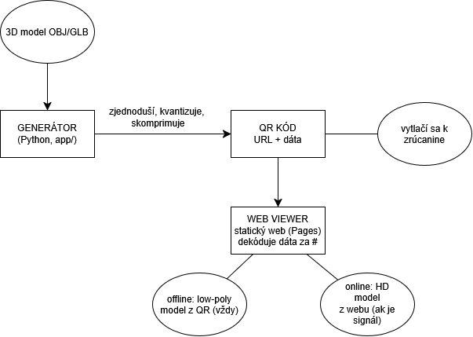

---
# 🧩 Versioning – systém dopĺňa automaticky
fm_version: "1.0.1"

# Dátum buildu – generuje skript
fm_build: "2026-10-26T08:24:38.489481+00:00"

# Poznámka k verzii – voliteľné
fm_version_comment: ""


# 🆔 IDENTITY --------------------------------------------------------

# ID generuje CLI / skript

# Unikátne UUID – generuje skript
guid: "0b824284-f523-45b8-a564-e8fb7cff5587"


# 🧭 CONTEXT ---------------------------------------------------------

# DAO / doména (knife, sdlc, q12, 7ds...) dopĺňa skript
dao: "sthdf"

# Názov zápisu – dopĺňa používateľ
title: "D4 - Design"

# Krátky popis – dopĺňa používateľ (voliteľné)
description: "Návrh riešenia QR3D – architektúra, dátový formát v QR kóde a návrh používateľského rozhrania."


# 👥 AUTHORSHIP ------------------------------------------------------

# Hlavný autor – z globálneho configu
author: "Roman Kazicka"

# Zoznam autorov – generuje skript
authors:
  - "Dániel Ruzsik"
  - "Lukáš Šebök"


# 🗂 CLASSIFICATION ---------------------------------------------------

# Nadradená kategória – môže doplniť používateľ
category: ""

# Typ dokumentu (guide, case, tutorial...) – používateľ (voliteľné)
type: ""

# Priorita (low/medium/high) – voliteľné
priority: ""

# Tagy – odporúča sa 2–6 tagov.
# Typy tagov:
#   - rámce: knife, 7ds, sdlc, q12
#   - účel: tutorial, guide, pattern, case-study
#   - téma: git, backup, ai, communication
#   - úroveň: beginner, intermediate, advanced
tags: []


# 🌍 LOCALIZATION -----------------------------------------------------

# Jazyk dokumentu – doplní skript podľa štruktúry
locale: "sk"


# 🕒 LIFECYCLE --------------------------------------------------------

# Dátum vytvorenia – generuje skript
created: "2026-10-26 09:24"

# Dátum poslednej úpravy – dopĺňa človek
modified: "2026-10-26 09:24"

# Stav dokumentu – default "backlog"
status: "backlog"

# Viditeľnosť – default "public"
privacy: "public"


# ⚖ INTELLECTUAL PROPERTY -------------------------------------------

# Držiteľ práv k obsahu – dopĺňa skript
rights_holder_content: "Roman Kazicka"

# Systémový vlastník práv
rights_holder_system: "CAA / KNIFE / LetItGrow"

# Licencia
license: "CC-BY-NC-SA-4.0"

# Disclaimer
disclaimer: "Use at your own risk. Methods provided as-is; participation is voluntary and context-aware."

# Copyright
copyright: "© 2025 Roman Kazicka"


# 🔗 ORIGIN / PROVENANCE ---------------------------------------------

# Repozitár pôvodu
origin_repo: ""

# URL pôvodného repozitára
origin_repo_url: ""

# Commit pôvodu
origin_commit: ""

# Branch pôvodu
origin_branch: ""

# Systém pôvodu (CAA/KNIFE/STHDF…)
origin_system: "CAA"

# Pôvodný autor
origin_author: "Roman Kazicka"

# Importovaný zdroj
origin_imported_from: ""

# Dátum importu
origin_import_date: ""


# 🧱 RESERVED ---------------------------------------------------------

fm_reserved1: ""
fm_reserved2: ""
---

<!-- SDLC_INSTANCE_ID: PRJ-000-QR3D -->

# D4 – Design

*Stav: návrh – spresníme po experimente s kapacitou QR (M4).*

## 🏗️ Architektúra



*Obrázok 1: Architektúra riešenia QR3D. Zdroj diagramu: `img/qr3d.drawio.png` (dá sa otvoriť v draw.io).*

## 🧩 Komponenty

| Komponent | Úloha | Technológia |
|-----------|-------|-------------|
| **Generátor** | 3D súbor → zjednodušený model → bajty → QR kód (PNG/SVG) | Python |
| **Web viewer** | prečíta dáta z URL, dekóduje model, zobrazí ho, voliteľne načíta HD verziu | HTML + JavaScript, three.js |
| **HD modely** | detailné verzie modelov (GLB) | statické súbory na GitHub Pages |
| **Maketa** | fyzická ukážka s nalepeným QR kódom | kartón / 3D tlač |

## 📦 Formát dát v QR kóde (návrh)

QR kód obsahuje bežnú webovú adresu, napr.:

```text
https://xruzsik.github.io/PRJ-000-QR3D/viewer/#m=ÚDAJE_MODELU&hd=zobor
```

- Časť za znakom `#` (fragment) prehliadač **nikdy neposiela na server** – viewer ju prečíta priamo v telefóne, preto to funguje aj offline (ak je viewer uložený v cache) a so statickým webom.
- `hd=zobor` je voliteľný identifikátor detailného modelu na webe.

Štruktúra `ÚDAJE_MODELU` (pred kompresiou):

| Časť | Obsah |
|------|-------|
| hlavička | verzia formátu, počet vrcholov, počet trojuholníkov, počet období |
| ohraničenie | minimum a maximum súradníc (bounding box) |
| vrcholy | súradnice x, y, z kvantizované na 10 bitov v rámci ohraničenia |
| trojuholníky | indexy vrcholov, rozdielovo zakódované (delta) |
| obdobia *(bonus)* | ku každému trojuholníku značka, v ktorom období stavba existovala |

Celé sa skomprimuje (deflate) a zakóduje do textu bezpečného pre URL (base64url).

## 📱 Návrh rozhrania viewera

- **Na celú obrazovku 3D model**, otáčanie prstom, priblíženie dvoma prstami.
- Hore **názov lokality** a označenie *„ilustračná rekonštrukcia“*.
- Dole **posuvník období** (bonus), napr. 12. stor. → 15. stor. → dnes.
- Tlačidlo **„Načítať detailný model“** (zobrazí sa, len ak je pripojenie).
- Tlačidlo **„ℹ️ O stavbe“** – krátky text a zdroje.
- *(bonus)* tlačidlo **„Zobraziť v AR“**.

---
**Navigation:** [⬆️ Up](../index.md) · [🏠 Home](../index.md)
